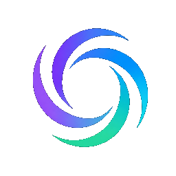
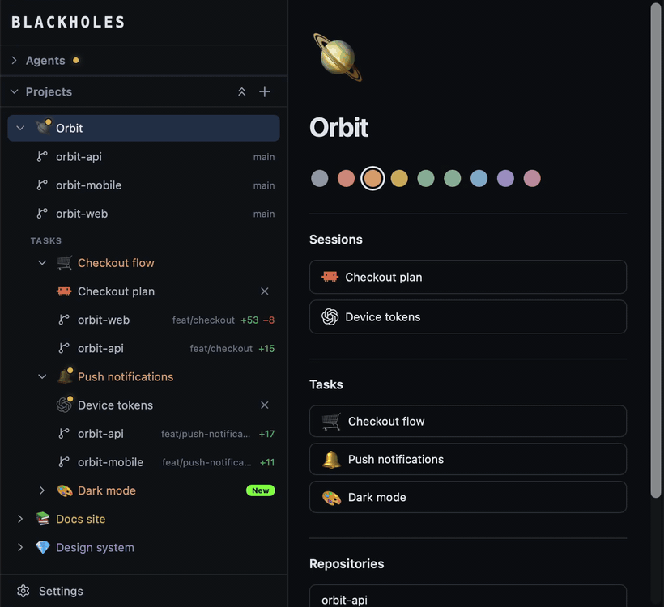
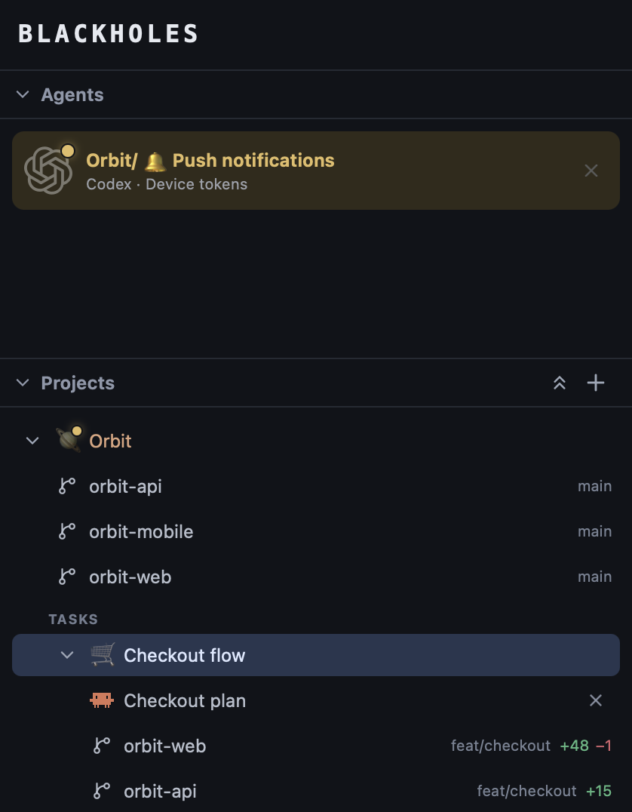
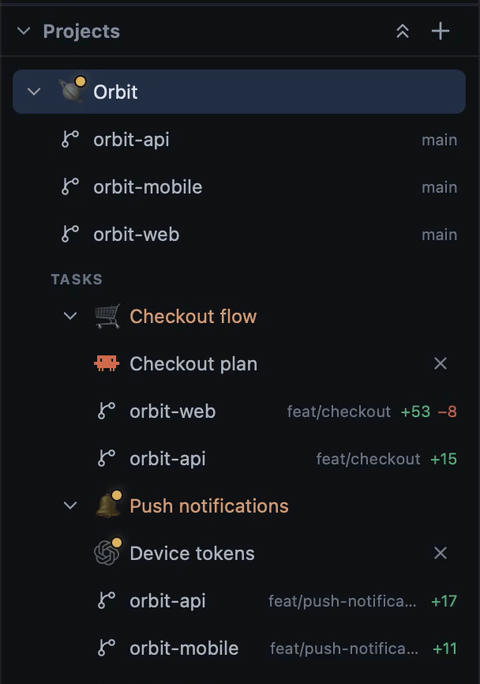
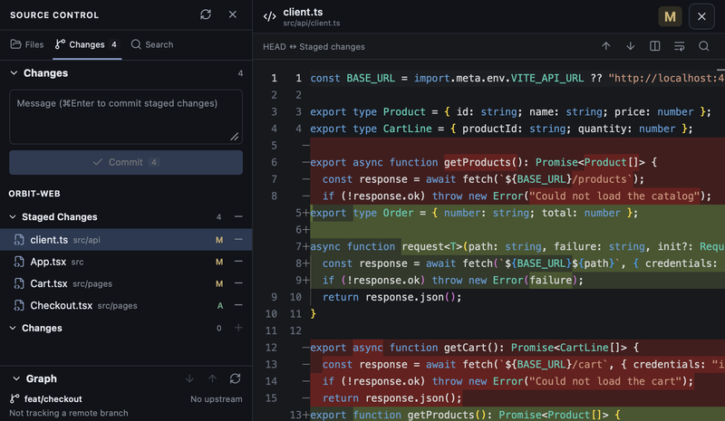

  

<h1 align="center">Blackholes</h1>

<strong>Your workspace for coding agents, terminals, and Git worktrees.</strong>

Run your installed agent CLIs side by side. Organize sessions by project and task, keep repositories together, and give every task its own working context.

  
  
  
  
  
  

<h2 align="center"><a href="https://blackholes.dev/">Download Blackholes for macOS</a></h2>

Current version: <a href="docs/releases/0.1.19.md">0.1.19</a>

macOS 13+ · Apple Silicon · <a href="docs/README.md">Documentation</a> · <a href="CONTRIBUTING.md">Contributing</a>

[Watch the recording](https://blackholes.dev/videos/blackholes-repositories.mp4)

## Features

| | |
| --- | --- |
| **Agent sessions**  Run Claude Code, Codex and Antigravity in native terminals, organized by project and task. |  |
| **Multiple repositories**  Keep repositories together and create isolated Git worktrees for each task.  [Watch →](https://blackholes.dev/videos/blackholes-repositories.mp4) |  |
| **Changes and diffs**  Review each repository's changes, stage and commit them, and read the diff without leaving the workspace. |  |

- Tasks with a living context document and multiple PR, ClickUp, Slack and other links.
- Terminal sessions, file editing, and repository-wide text search.
- Green and yellow agent notifications, working indicators, and a resizable Agents/Projects split.
- Git staging, manual commits, history, commit diffs, and push.
- Local Claude, Codex and Antigravity usage, refreshed every 10 minutes for the agents you select.
- The latest three releases in the workspace, with a shortcut beside the version and a link to the full history.
- MCP tools to create tasks and launch agents from your existing clients.

## Supported agents

Use your installed CLIs and your own accounts. [Setup guide →](docs/USAGE.md)

## Contributing

Bug reports, fixes, and documentation improvements are welcome. Read the
[contribution guide](CONTRIBUTING.md) and [build instructions](docs/BUILDING.md).

## Star history

<a href="https://www.star-history.com/?repos=andygeek%2Fblackholes&amp;type=date">
  <picture>
    <source media="(prefers-color-scheme: dark)" srcset="https://api.star-history.com/svg?repos=andygeek/blackholes&amp;type=Date&amp;theme=dark" />
    <source media="(prefers-color-scheme: light)" srcset="https://api.star-history.com/svg?repos=andygeek/blackholes&amp;type=Date" />
    
  </picture>
</a>

## License

[MPL-2.0](LICENSE). See [licensing](LICENSING.md) and [third-party notices](THIRD_PARTY_NOTICES.md).
